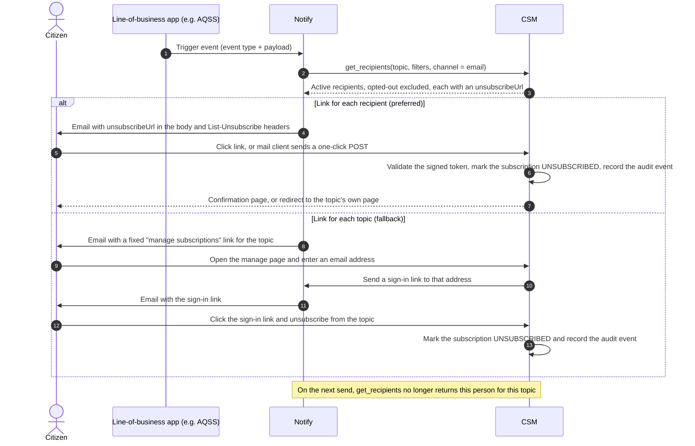
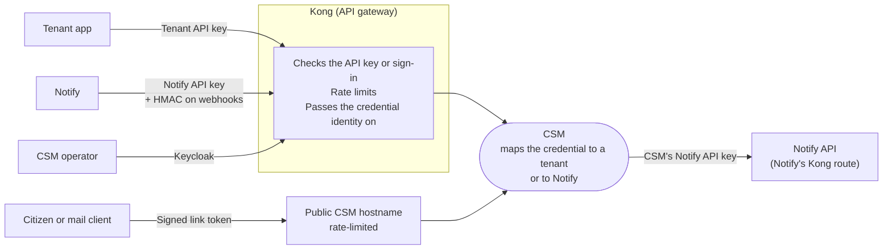

# Common Subscription Manager (CSM)

A headless, multi-tenant service that manages who is subscribed to which topics, on which channel, and whether they can be contacted. It sends through [Notify](https://github.com/bcgov/common-notify) but is not part of it.

## Ways to opt out

A subscriber can stop messages in several ways. Only a plain **STOP** applies to everything; every other way applies to **one topic**.

| Action | Channel | Scope | Handled by |
|---|---|---|---|
| Reply `STOP` | SMS | Every topic sent from that number, across all tenants on a shared number | The SMS provider blocks the number itself; CSM records it so `get_recipients` stays in step |
| Reply a topic keyword, e.g. `AQ OFF` | SMS | That topic only | CSM |
| Tap the short link in the text | SMS | That topic only | CSM (hosted page) |
| Click the unsubscribe link, or the mail client's one-click unsubscribe | Email | That topic only | CSM (hosted page or one-click endpoint) |
| Use the "manage subscriptions" page | Email or SMS | Any of the person's topics, chosen by them | CSM (hosted page) |
| Reply `START` | SMS | Undoes `STOP`: the number is unblocked and the person's topic subscriptions resume as they were | The SMS provider and CSM |

Notes:
- Carriers require `STOP` to stop everything from a number, and providers enforce it before any of our code runs. We can't make it apply to one topic.  We can, however, send one more notification after a stop request, and this can include a description of what STOP does, how to START again, or perhaps ultimately a link that takes citizens to CSM's notification management screen (TBD).
- `STOP` pauses delivery; it doesn't delete subscriptions. That's what lets `START` restore them.
- Topic keywords are unique for each sender number. They must not use any provider's reserved opt-out words, such as `STOP`, `END`, `CANCEL`, `QUIT` or `UNSUBSCRIBE`.  Can be managed in AWS.
- CSM hosts the unsubscribe and manage pages. Each topic can instead redirect to its own page after the change is made.
- Notify owns the phone numbers and receives every inbound text from the provider. It forwards them to CSM as webhooks, and CSM never connects to an SMS provider directly.

## Email unsubscribe

Every email sent to subscribers carries a way out. The service supports two ways, so it works whatever Notify can put into a template:

- **Link for each recipient (preferred):** `get_recipients` returns a signed `unsubscribeUrl` with each recipient. Notify puts it in the email body and in the `List-Unsubscribe` headers, so the person unsubscribes in one click.
- **Link for each topic (fallback):** a fixed "manage subscriptions" link in the template. The person enters their email address and gets a sign-in link to manage their subscriptions. It takes two steps, but Notify only needs fixed text.

Either way, the person is unsubscribed from **that topic only**, and the next `get_recipients` call leaves them out.

## Integration and authentication

Services call CSM the same way they call Notify: **through Kong (the API gateway), with an API key from the API Services Portal**. Kong checks the key and applies rate limits. It then tells CSM which credential was used, and CSM maps that credential to a tenant. Only the public links skip API keys, because the token in the link is the permission.

| Caller | Route | How it authenticates | What it can do |
|---|---|---|---|
| **Tenant app** (a line-of-business service) | Kong | Its API key, in the `X-API-KEY` header | Manage its own topics, subscribers and suppressions. Every call is limited to that tenant's data. |
| **Notify**: recipient queries | Kong | **Notify's own API key**, separate from every tenant's | Query recipients for any tenant, naming the tenant in each request. Notify never borrows a tenant's key. |
| **Notify**: inbound SMS and delivery webhooks | Kong | The same Notify key, **plus** an HMAC signature on the body | Report STOP/START, keyword replies, bounces and complaints. The signature proves the body wasn't altered. |
| **CSM → Notify** (confirmations, keyword replies, sign-in links) | Notify's Kong route | CSM's own Notify API key | Send messages. CSM is just another Notify client. |
| **The public** (links in emails and texts, mail clients' one-click unsubscribe) | A public CSM hostname, rate-limited | No key: the signed token in the link | Confirm, unsubscribe or manage that person's own subscriptions. |
| **CSM operators** | Kong | Keycloak sign-in | Set up tenants and map API keys to them. |

Notes:
- **Calls go through Kong, even from Notify.** Notify and CSM run in different OpenShift namespaces. Calling CSM directly would need cross-namespace network rules and a second authentication method, and would bypass Kong's rate limits and logs. Recipients come back up to 1,000 at a time, so even a large send needs only a few gateway calls.
- **CSM trusts the identity headers only from Kong.** A network policy stops anything except the Kong gateway, and the route for public links, from reaching the backend.
- **Mapping keys to tenants:** in the MVP a CSM operator does this through the admin API. Tenants will do it themselves in phase 2.
- **Notify calls the REST API directly.** The MCP tools are for other services and AI agents that discover tools at runtime. They sit behind Kong and use the same keys.

Still to decide:
- **Whose name confirmations are sent under.** Either **(A)** CSM sends as itself, with one sender for every tenant, or **(B)** CSM sends on behalf of the tenant, using the tenant's own Notify templates, sender and usage limits. B is recommended, because it's what citizens expect and it keeps each tenant's usage accurate. It needs a trusted "send on behalf of" capability in Notify.
- **Whether the API Services Portal can issue one key that works for both Notify and CSM**, which would make onboarding simpler. To be checked with the API Services Portal team.

## Design

- [Data model (draft)](docs/data-model.md)
- [API specification (draft, OpenAPI 3.1)](docs/openapi.yaml)
