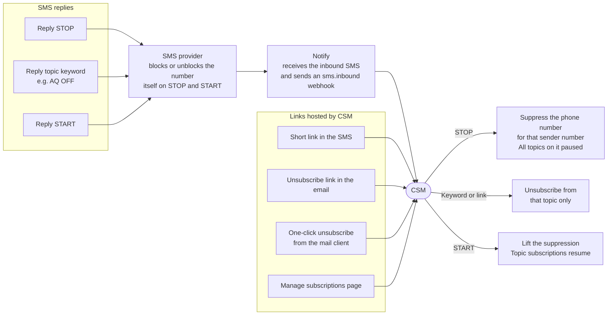
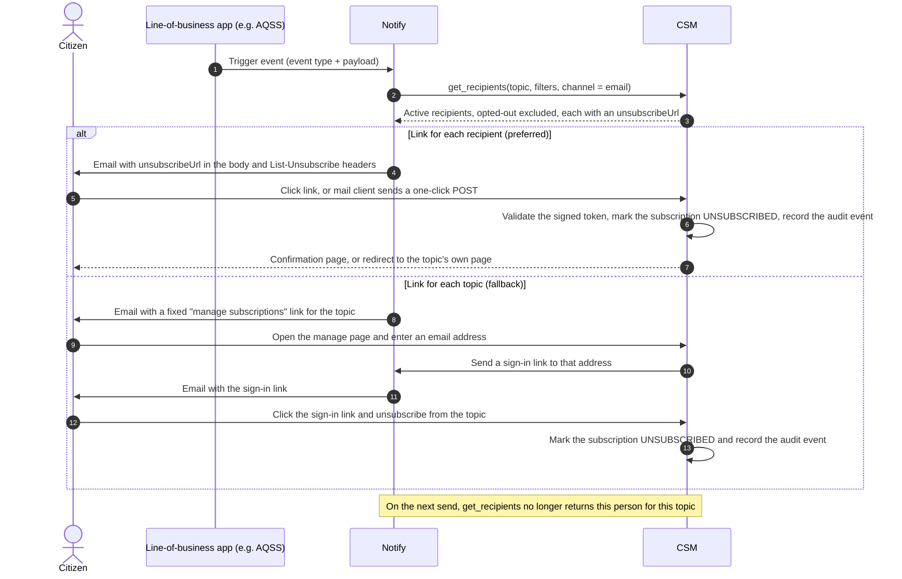

# Common Subscription Manager (CSM)

A headless, multi-tenant service that manages who is subscribed to which topics, on which channel, and whether they can be contacted. It sends through [Notify](https://github.com/bcgov/common-notify) but is not part of it.

## Ways to opt out

A subscriber can stop messages in several ways. Only a plain **STOP** applies to everything; every other way applies to **one topic**.

| Action | Channel | Scope | Handled by |
|---|---|---|---|
| Reply `STOP` | SMS | Every topic sent from that number, across all tenants on a shared number | The SMS provider blocks the number itself; CSM records it so `get_recipients` stays in step |
| Reply a topic keyword, e.g. `AQ OFF` | SMS | That topic only | CSM |
| Tap the short link in the text | SMS | That topic only | CSM (hosted page) |
| Click the unsubscribe link, or the mail client's one-click unsubscribe | Email | That topic only | CSM (hosted page or one-click endpoint) |
| Use the "manage subscriptions" page | Email or SMS | Any of the person's topics, chosen by them | CSM (hosted page) |
| Reply `START` | SMS | Undoes `STOP`: the number is unblocked and the person's topic subscriptions resume as they were | The SMS provider and CSM |

Notes:
- Carriers require `STOP` to stop everything from a number, and providers enforce it before any of our code runs. We can't make it apply to one topic.
- `STOP` pauses delivery; it doesn't delete subscriptions. That's what lets `START` restore them.
- Topic keywords are unique for each sender number. They must not use any provider's reserved opt-out words, such as `STOP`, `END`, `CANCEL`, `QUIT` or `UNSUBSCRIBE`.
- CSM hosts the unsubscribe and manage pages. Each topic can instead redirect to its own page after the change is made.
- Notify owns the phone numbers and receives every inbound text from the provider. It forwards them to CSM as webhooks, and CSM never connects to an SMS provider directly.

## Email unsubscribe

Every email sent to subscribers carries a way out. The service supports two ways, so it works whatever Notify can put into a template:

- **Link for each recipient (preferred):** `get_recipients` returns a signed `unsubscribeUrl` with each recipient. Notify puts it in the email body and in the `List-Unsubscribe` headers, so the person unsubscribes in one click.
- **Link for each topic (fallback):** a fixed "manage subscriptions" link in the template. The person enters their email address and gets a sign-in link to manage their subscriptions. It takes two steps, but Notify only needs fixed text.

Either way, the person is unsubscribed from **that topic only**, and the next `get_recipients` call leaves them out.

## Design

- [Data model (draft)](docs/data-model.md)
- [API specification (draft, OpenAPI 3.1)](docs/openapi.yaml)
