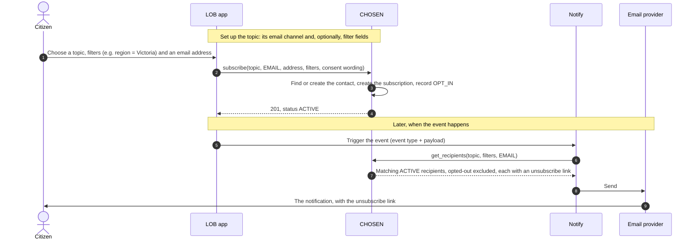
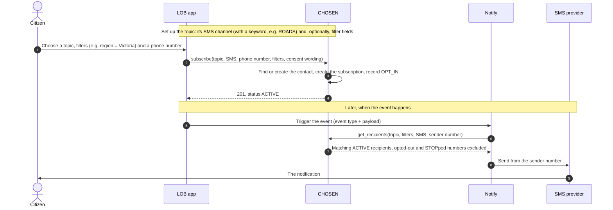
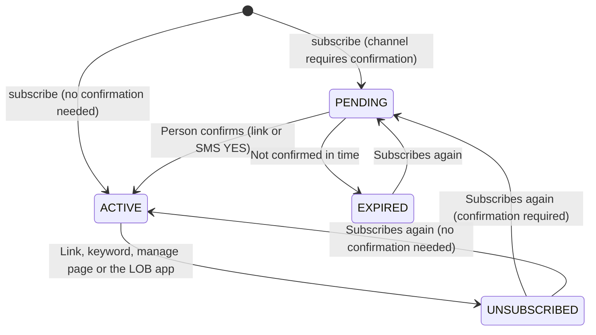
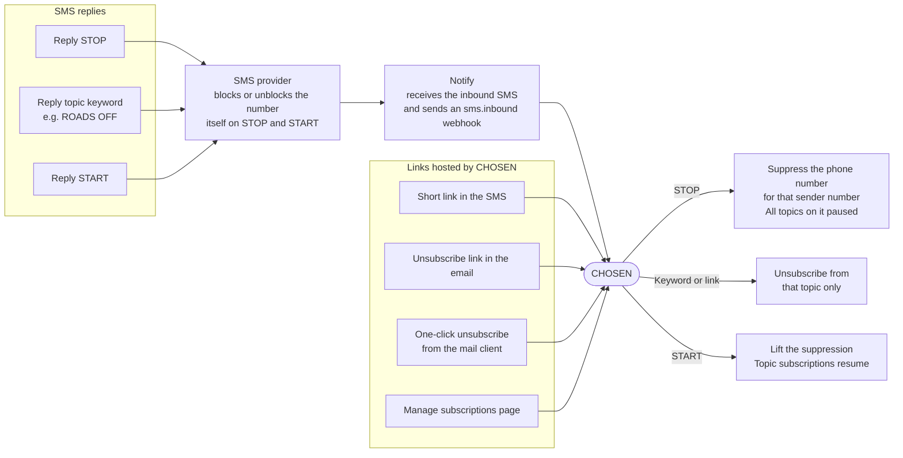
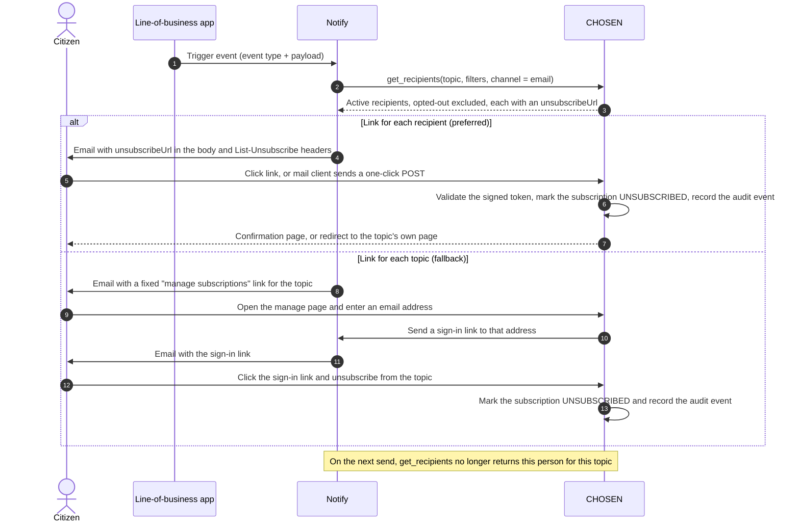
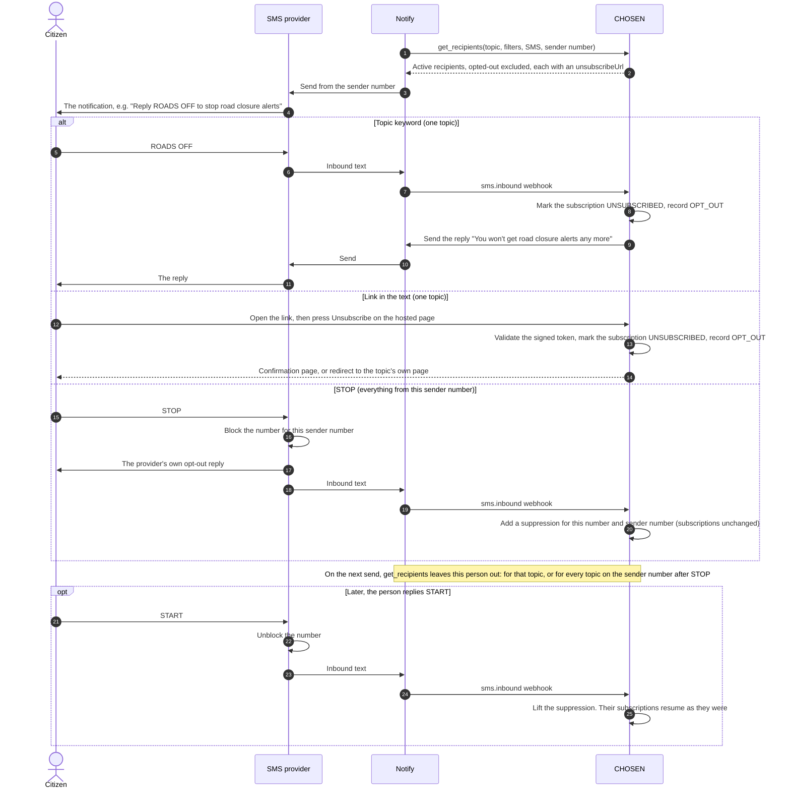
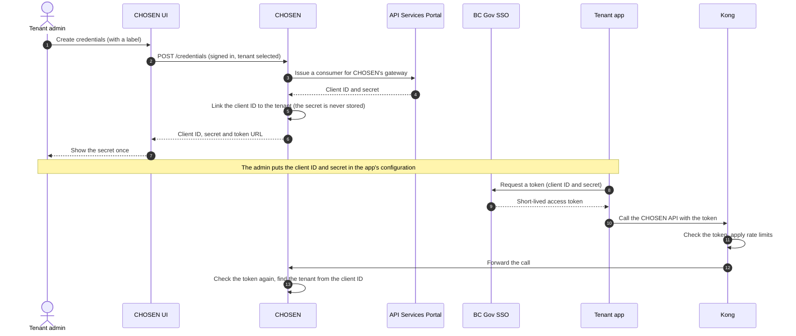
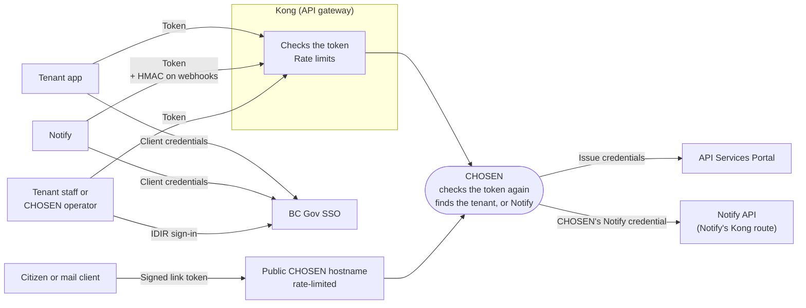

# Common Hosted Subscription for Event Notifications (CHOSEN)

A headless, multi-tenant service that manages who is subscribed to which topics, on which channel, and whether they can be contacted. It sends through [Notify](https://github.com/bcgov/common-notify) but is not part of it.

It does three things for any line-of-business (LOB) app:
1. **Subscribe** people to a topic, with their channel, address and filters, and keep proof that they agreed.
2. **Unsubscribe** them from one topic, or stop everything, in whatever way they choose.
3. **Return the recipients** for a topic when an event happens, leaving out anyone who has opted out.

It also handles the rules that come with them: confirming addresses, SMS opt-out keywords, consent history and audit, and encrypting personal data.

## Glossary

| Term | Meaning |
|---|---|
| **Tenant** | A service that uses CHOSEN, such as a road-conditions service. Each tenant sees only its own topics and subscribers. It's the same tenant as in Notify and CSTAR. |
| **LOB app** | Line-of-business app: the tenant's own application. People subscribe there, and it calls CHOSEN's API. |
| **Topic** | Something people can subscribe to, such as "road closures". Each tenant creates its own. |
| **Channel** | How a message is delivered: email or SMS. |
| **Filter** | A choice that narrows a topic, such as `region = Victoria`. A person can pick several values. A filter they leave empty matches everything. |
| **Contact** | One verified email address or phone number, belonging to one tenant. |
| **Subscription** | One contact signed up to one topic, with their filters. |
| **Double opt-in** | The person must confirm before messages start: by clicking a link (email) or replying `YES` (SMS). It's switched on or off for each channel of a topic, so a topic can confirm SMS but not email. |
| **Pending** | A subscription waiting for confirmation. If it isn't confirmed in time, it expires. |
| **Opt-out / unsubscribe** | The person stops messages from one topic, by link, by the manage page, or by texting a keyword such as `ROADS OFF`. |
| **Keyword** | A short word for a topic, such as `ROADS`. People text `ROADS YES` to confirm and `ROADS OFF` to unsubscribe. Each keyword is unique across CHOSEN. |
| **STOP / START** | Texting `STOP` stops **everything** sent from that phone number, for every tenant using it. `START` undoes it. Carriers require this. |
| **Suppression** | "Don't send to this address", for example after `STOP` or an email that bounced. It pauses messages without deleting subscriptions. |
| **Sender number** | The phone number or short code a text comes from. Notify owns these, and several tenants may share one. |
| **Recipients** | The people a message goes to. Notify asks CHOSEN for them each time it sends (`get_recipients`). Anyone opted out or suppressed is left out. |
| **Consent event** | A permanent record of each time someone subscribed, confirmed, changed filters or opted out, with the wording they were shown. It's the proof of consent. |
| **Manage page** | CHOSEN's web page where a person can see and change their own subscriptions. |

## How subscribing works

**The LOB app owns the subscribe experience; CHOSEN stores and enforces the result.** Only the LOB app knows what its events mean, which filters make sense (a region, a threshold, a stock symbol), and who its user is. It might take the address from the person's sign-in, such as BC Services Card, or ask for it. CHOSEN has no subscribe screen of its own.

1. **Set up the topic:** the LOB app, or a CHOSEN operator, creates the topic in CHOSEN with:
   - its channels (email, SMS), each with its own double opt-in setting and confirmation message;
   - its SMS keyword, such as `ROADS`;
   - optionally, its **filter fields**: the ways people can narrow the topic, such as `region` or `highway`. Fields can be added, changed or removed later. A field added later matches everything for existing subscribers until they choose values.
2. **The person subscribes in the LOB app.** The app calls CHOSEN's `subscribe` with the channel, the address, the chosen filters, and the consent wording the person was shown.
3. **CHOSEN records it.** It finds or creates the contact (the address is encrypted, with a lookup hash), creates the subscription, and saves a consent event as proof.
4. **CHOSEN confirms the address, if the channel requires it (double opt-in).** Each of a topic's channels has its own `confirmationRequired` flag, so a topic can, for example, confirm SMS subscriptions but not email ones. When it's on, the subscription stays `PENDING` and CHOSEN sends a confirmation message through Notify:
   - **Email:** the person clicks the link and presses Confirm on CHOSEN's hosted page.
   - **SMS:** the person replies `YES`, or `<keyword> YES` (e.g. `ROADS YES`). The message can also include the link.

   The subscription then becomes `ACTIVE`. If nobody confirms in time, it becomes `EXPIRED` and nothing is ever sent to it. When the flag is off, the subscription is `ACTIVE` straight away.
5. **From then on, the person receives messages.** When the event happens, Notify asks CHOSEN for the recipients, and this subscription is included if its filters match.

People change their filters, or their address, through the LOB app (which calls CHOSEN's API) or on CHOSEN's "manage subscriptions" page. A new address goes through confirmation again before anything moves to it.

### Subscribing by email

**Double opt-in (optional):** the subscription starts as `PENDING` and CHOSEN emails a confirmation link. The person opens it and presses Confirm, and the subscription becomes `ACTIVE`. Opening the link alone does nothing, because mail scanners open links automatically.

### Subscribing by SMS

**Double opt-in (optional):** the subscription starts as `PENDING` and CHOSEN texts "Reply YES to confirm". The reply comes back through Notify, and the subscription becomes `ACTIVE`. If the person has more than one pending subscription on that number, they're asked to reply with the keyword instead, such as `ROADS YES`.

### Subscription states

A subscription moves through these states. A suppression, such as STOP or a hard bounce, doesn't change the state; it only keeps the address out of `get_recipients` until the suppression is lifted.

## Ways to opt out

A subscriber can stop messages in several ways. Only a plain **STOP** applies to everything; every other way applies to **one topic**.

| Action | Channel | Scope | Handled by |
|---|---|---|---|
| Reply `STOP` | SMS | Every topic sent from that number, across all tenants on a shared number | The SMS provider blocks the number itself; CHOSEN records it so `get_recipients` stays in step |
| Reply a topic keyword, e.g. `ROADS OFF` | SMS | That topic only | CHOSEN |
| Tap the short link in the text | SMS | That topic only | CHOSEN (hosted page) |
| Click the unsubscribe link, or the mail client's one-click unsubscribe | Email | That topic only | CHOSEN (hosted page or one-click endpoint) |
| Use the "manage subscriptions" page | Email or SMS | Any of the person's topics, chosen by them | CHOSEN (hosted page) |
| Reply `START` | SMS | Undoes `STOP`: the number is unblocked and the person's topic subscriptions resume as they were | The SMS provider and CHOSEN |

Notes:
- Carriers require `STOP` to stop everything from a number, and providers enforce it before any of our code runs. We can't make it apply to one topic.  We can, however, send one more notification after a stop request, and this can include a description of what STOP does, how to START again, or perhaps ultimately a link that takes citizens to CHOSEN's notification management screen (TBD).
- `STOP` pauses delivery; it doesn't delete subscriptions. That's what lets `START` restore them.
- Topic keywords are unique for each sender number. They must not use any provider's reserved opt-out words, such as `STOP`, `END`, `CANCEL`, `QUIT` or `UNSUBSCRIBE`.  Can be managed in AWS.
- CHOSEN hosts the unsubscribe and manage pages. Each topic can instead redirect to its own page after the change is made.
- Notify owns the phone numbers and receives every inbound text from the provider. It forwards them to CHOSEN as webhooks, and CHOSEN never connects to an SMS provider directly.

## Email unsubscribe

Every email sent to subscribers carries a way out. The service supports two ways, so it works whatever Notify can put into a template:

- **Link for each recipient (preferred):** `get_recipients` returns a signed `unsubscribeUrl` with each recipient. Notify puts it in the email body and in the `List-Unsubscribe` headers, so the person unsubscribes in one click.
- **Link for each topic (fallback):** a fixed "manage subscriptions" link in the template. The person enters their email address and gets a sign-in link to manage their subscriptions. It takes two steps, but Notify only needs fixed text.

Either way, the person is unsubscribed from **that topic only**, and the next `get_recipients` call leaves them out.

## SMS unsubscribe

A person can stop texts in three ways. The first two stop **one topic**; `STOP` stops **everything** from that sender number.

- **Reply the topic keyword with `OFF`**, such as `ROADS OFF`. CHOSEN unsubscribes them from that topic and replies to confirm.
- **Tap the unsubscribe link** in the text. `get_recipients` returns a signed `unsubscribeUrl` for SMS recipients too, and it opens CHOSEN's hosted page.
- **Reply `STOP`.** The SMS provider blocks the number itself and sends its own reply. CHOSEN adds a suppression, so `get_recipients` leaves the number out for every topic and tenant on that sender number. Subscriptions aren't changed, so `START` brings them all back.

## Integration and authentication

Services call CHOSEN **through Kong (the API gateway), with OAuth2 client credentials**. A tenant creates its credentials inside CHOSEN: CHOSEN asks the API Services Portal (APS) to issue them, and links them to the tenant as they're issued. The service exchanges its client ID and secret for a short-lived token, and sends the token with each call. Kong checks the token and applies rate limits, then CHOSEN checks it again and looks up which tenant the client belongs to. Only the public links skip credentials, because the token in the link is the permission.

| Caller | Route | How it authenticates | What it can do |
|---|---|---|---|
| **Tenant app** (a line-of-business service) | Kong | A token from its tenant's client credentials | Manage its own topics, subscribers and suppressions. Every call is limited to that tenant's data. |
| **Notify**: recipient queries | Kong | A token from **Notify's own client credentials**, which belong to no tenant | Query recipients for any tenant, naming the tenant in each request. |
| **Notify**: inbound SMS and delivery webhooks | Kong | The same Notify token, **plus** an HMAC signature on the body | Report STOP/START, keyword replies, bounces and complaints. The signature proves the body wasn't altered. |
| **CHOSEN → Notify** (confirmations, keyword replies, sign-in links) | Notify's Kong route | CHOSEN's own Notify credential | Send messages. CHOSEN is just another Notify client. |
| **The public** (links in emails and texts, mail clients' one-click unsubscribe) | A public CHOSEN hostname, rate-limited | Nothing extra: the signed token in the link | Confirm, unsubscribe or manage that person's own subscriptions. |
| **Tenant staff** (CHOSEN's UI) | Kong | IDIR sign-in, plus a CHOSEN role for the tenant in CSTAR | Manage the tenant's topics and settings, and its client credentials. |
| **CHOSEN operators** | Kong | IDIR sign-in, plus the `CHOSEN_ADMIN` role | Set up tenants, and issue Notify's credentials. |

### Getting client credentials

- **The secret is shown once.** CHOSEN doesn't keep it. If it's lost, rotate the credentials to get a new secret; the client ID stays the same.
- **Revoking** takes effect in CHOSEN immediately: the client ID is no longer linked to the tenant, so its tokens are refused. The APS API can't delete the consumer yet, so it's also removed in the portal by hand.
- **A tenant can have several credentials**, for example one for each app or environment, each with its own label.
- **Notify's credentials** are issued the same way by a CHOSEN operator, but linked to the Notify role instead of a tenant.

### How it fits together

Notes:
- **Why client credentials, not API keys:** CHOSEN holds citizens' contact details. A leaked API key works until someone notices, while a stolen token expires within minutes. The secret itself goes only to SSO, never with each request. Notify uses API keys so that GC Notify users can keep theirs; CHOSEN has no such users.
- **CHOSEN checks every token itself**, not just Kong. So a client that's been revoked, or a request that somehow avoids Kong, is still refused.
- **Calls go through Kong, even from Notify.** Notify and CHOSEN run in different OpenShift namespaces. Calling CHOSEN directly would need cross-namespace network rules and would bypass Kong's rate limits and logs. Recipients come back up to 1,000 at a time, so even a large send needs only a few gateway calls.
- **Notify calls the REST API directly.** The MCP tools are for other services and AI agents that discover tools at runtime. They sit behind Kong and use the same credentials.

Still to decide:
- **Whose name confirmations are sent under.** Either **(A)** CHOSEN sends as itself, with one sender for every tenant, or **(B)** CHOSEN sends on behalf of the tenant, using the tenant's own Notify templates, sender and usage limits. B is recommended, because it's what citizens expect and it keeps each tenant's usage accurate. It needs a trusted "send on behalf of" capability in Notify.
- **Whether the API Services Portal will add an API to delete consumers.** Until then, revoking credentials in CHOSEN is immediate, but the consumer has to be removed in the portal by hand. Issuing, token claims and rotation were confirmed against CHOSEN's dev environment on 2026-11-26; see [api-gateway/README.md](api-gateway/README.md#client-credentials-check-2026-11-26).

## Design

- [Data model (draft)](docs/data-model.md)
- [API specification (draft, OpenAPI 3.1)](docs/openapi.yaml)
