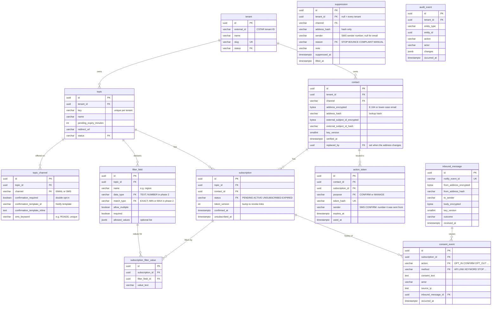

# CSM data model (draft for review)

This is the first draft of the Common Subscription Manager (CSM) data model. It follows Notify's conventions:

- tables and columns in `snake_case`, in their own Postgres schema (`csm`)
- UUID primary keys
- lookup tables (`*_code`) for statuses and types, not Postgres enums
- `created_at`, `created_by`, `updated_at` and `updated_by` on every table that can change (left out of the diagram)
- Flyway SQL owns the schema; TypeORM entities map to it with `synchronize: false`

## Decisions this model is built on

| # | Decision |
|---|---|
| 1 | A subscriber chooses **topics**. Each topic declares its own **filter fields**, which makes the model generic. Phase 1 supports exact matches; a field can take several values. Phase 2 adds numeric thresholds. |
| 2 | The concept is called a **topic**, not an event, so it isn't tied one-to-one to a Notify event type. |
| 3 | CSM stores **verified addresses**, plus an optional external subject ID. It doesn't look up identities from other systems. |
| 4 | `STOP` opts a number out of everything sent from that sender number. Topic keywords (e.g. `ROADS OFF`) and links hosted by CSM opt out of one topic. |
| 5 | Notify owns the phone numbers and receives inbound texts. It forwards them to CSM as webhooks, and CSM never connects to an SMS provider. |
| 6 | Unsubscribe links for each recipient, plus a "manage subscriptions" page for each topic. |
| 7 | `get_recipients` leaves out anyone opted out or suppressed; Notify doesn't filter. |
| 8 | Confirm and unsubscribe pages are hosted by CSM, with an optional redirect for each topic. |
| 9 | REST with an OpenAPI spec is the source of truth, plus a thin MCP layer for Notify. |
| 10 | Multi-tenant, aligned with CSTAR. A **contact belongs to one tenant**: the same address used with two tenants is two contacts. |
| 11 | One subscription per contact and topic. Several filter values sit on that one subscription, and the API can change them without resubscribing. |
| 12 | An email spam complaint suppresses the address only for the tenant whose email was reported. A hard bounce suppresses it for every tenant. |
| 13 | Topic keywords are unique across CSM. |
| 14 | Personal data is encrypted in the application before it reaches the database, with a keyed hash alongside for lookups. See [Encryption](#encryption). |

## Diagram

## Tables

### Tenants and topics

**`tenant`**: a service that uses CSM. `external_id` holds the CSTAR tenant ID, the same one Notify uses, so the two systems agree on who a tenant is. Every API call authenticates as a tenant and sees only its own data.

**`topic`**: something a person can subscribe to, such as road-closure alerts. Its `key` is what apps and Notify pass to the API, and it's unique within a tenant.
- `pending_expiry_minutes`: how long an unconfirmed subscription waits before it becomes `EXPIRED`, on any channel that requires confirmation.
- `redirect_url`: where CSM's hosted pages send the person afterwards. If it's empty, CSM shows its own page.

**`topic_channel`**: which channels a topic offers, and the settings for each.
- **`confirmation_required`:** double opt-in, set per channel so a topic can, for example, confirm SMS but not email. New subscriptions on that channel stay `PENDING` until the person confirms: by the link for email, and by replying `YES` (or `<keyword> YES`) or the link for SMS. Changing it affects only new subscriptions.
- **Confirmation template:** either a Notify template ID or inline text. Required when `confirmation_required` is on.
- **`sms_keyword`:** used for topic opt-out (`ROADS OFF`). Keywords are **unique across all of CSM**, so every sender number recognises every topic keyword. `ROADS OFF` means the same topic whichever number it's sent to, so an inbound text can be matched to a topic without knowing which tenant it's for. Keywords are claimed first come, first served, and can't be one of the system keywords below or any provider's reserved word (`STOP`, `END`, `CANCEL`, `QUIT`, `UNSUBSCRIBE`, `START`, `HELP`, `INFO`, `YES`, …).
- The keyword is also used for SMS confirmation: `ROADS YES` confirms a pending subscription to that topic.
- **System keywords are separate:** `STOP`, `START`, `HELP`, `INFO` and `YES` behave the same on every number and belong to no topic.
- **A plain `YES`** confirms the pending subscription whose confirmation was sent to that phone from that sender number (`action_token.sender`). If several match, for example on a short code shared by tenants, nothing is confirmed and CSM asks the person to reply `<keyword> YES`. Confirming the wrong subscription would be worse than asking.

**`filter_field`**: the filter fields a topic declares; this is what keeps the model generic.
- Phase 1 allows only `data_type = TEXT` with `match_type = EXACT`.
- `allow_multiple`: the subscriber may choose several values.
- `allowed_values`: an optional list to check choices against, such as the valid region codes.

### Contacts and subscriptions

**`contact`**: a verified address that belongs to one tenant.
- It's unique on `(tenant_id, channel, address_hash)`.
- Addresses are normalised before they're stored: phone numbers in E.164 format, emails trimmed and lower-cased.
- The address and `external_subject_id` are stored encrypted, each with a lookup hash; see [Encryption](#encryption).
- `external_subject_id` is optional and free-form, for example the tenant's own user ID or a BCSC GUID. CSM stores it but never resolves it.
- Changing an address creates a new, unverified contact and moves the subscriptions across once it's verified, so the consent history stays tied to the address it was given for. The old contact's `replaced_by` then points to the new one.

**`subscription`**: one contact subscribed to one topic. It's unique on `(topic_id, contact_id)`.
- The channel comes from the contact.
- Statuses: `PENDING` → `ACTIVE` → `UNSUBSCRIBED`, or `PENDING` → `EXPIRED`.
- A `STOP` doesn't change the subscription. It adds a `suppression` instead, so `START` brings everything back as it was.

**`subscription_filter_value`**: one row for each value a subscriber chose. Filter values can be changed later through the API or the manage page without resubscribing; each change is recorded as a `FILTERS_CHANGED` consent event, for example two rows for `region = victoria` and `region = nanaimo`.
- A field with no rows matches anything.
- Rows are indexed on `(filter_field_id, value_text)`, so matching is an indexed lookup.
- Phase 2 adds `value_numeric` for threshold matches. No other table changes.

### Opt-outs and consent

**`suppression`**: "don't send to this address". It stores only the address's lookup hash, because matching never needs the address itself. Some rows apply to every tenant, so `tenant_id` is empty on those:

| Cause | `tenant_id` | `sender` | Applies to |
|---|---|---|---|
| SMS `STOP` | empty | the sender number | Every tenant sending from that number |
| Email hard bounce (the address doesn't exist) | empty | empty | Every tenant |
| Email spam complaint | the tenant whose email was reported | empty | That tenant only |
| Manual, by a tenant admin | that tenant | empty, or a sender number | That tenant only |

- `START` lifts a STOP by setting `lifted_at`; rows are never deleted.
- Tenants can see that one of their own contacts is suppressed, but not why, or for which other services.

**`consent_event`**: append-only proof of every change to a subscription, including filter changes (`FILTERS_CHANGED`). It records who did it, how (API, link, keyword, STOP, admin), what wording they were shown, when, and from which IP address. This is what we produce if anyone asks for evidence of consent.

**`inbound_message`**: each inbound text forwarded by Notify.
- `notify_event_id` is unique, so a webhook delivered twice is processed only once.
- `outcome` records what CSM did with the text, for example `STOP_APPLIED`, `KEYWORD_OPT_OUT`, `CONFIRMED` or `UNRECOGNISED`.

### Tokens and audit

**`action_token`**: short-lived links, stored only as a hash of the token:
- `CONFIRM`: confirms a subscription, by the link or, for SMS, by a `YES` reply. Single use, and expires with the pending subscription. For SMS, `sender` records the number the confirmation was sent from, so a plain `YES` can be matched to it.
- `MANAGE`: signs in to the manage page. It can be used repeatedly for 30 minutes, because the page makes several calls with it.

**Unsubscribe links are not stored in a table.** `get_recipients` would otherwise write a row for every recipient on every send. Each link instead carries a signed value made from the subscription ID and its `token_version`. CSM checks the signature when the link is used. Increasing `token_version` cancels all of that subscription's old links.

**`audit_event`**: changes to tenants, topics and settings, with who made each change and what changed. Subscription changes go in `consent_event`, not here.

### Lookup tables

`channel_code`, `tenant_status_code`, `topic_status_code`, `subscription_status_code`, `filter_data_type_code`, `filter_match_type_code`, `suppression_reason_code`, `consent_action_code`, `consent_method_code`, `token_purpose_code`.

## How `get_recipients` uses this

Notify calls `get_recipients(topic, channel, filters, sender)`. `sender` is the SMS number Notify will send from. CSM returns contacts that meet all of these conditions:
1. The contact has an `ACTIVE` subscription to the topic on that channel.
2. For every filter field where the subscriber chose values, at least one of their values is among the values Notify passed.
3. The contact has no active `suppression` for its address:
   - for SMS, none for this sender number, whether for every tenant or for this tenant;
   - for email, none that applies to every tenant, and none for this tenant.

Each recipient comes back with its address and a signed `unsubscribeUrl`. Results are returned a page at a time.

## Encryption

Addresses and other personal data are encrypted by CSM before they're written, so a leaked dump or backup, or someone querying the database directly, sees only encrypted values. The platform's disk and backup encryption stays on as well.

| Table | Encrypted | Lookup hash | Plain text |
|---|---|---|---|
| `contact` | `address`, `external_subject_id` | both | everything else |
| `suppression` | nothing stored | `address` | everything else |
| `inbound_message` | `from_address`, `body` | `from_address` | sender, outcome, times |

- **Encryption:** AES-256-GCM, with a fresh random nonce for each value. The nonce is stored with the encrypted value.
- **Lookup hash:** HMAC-SHA256 of the **normalised** value (E.164 phone, trimmed lower-case email). Unique constraints and lookups by address use the hash, so queries never need the plain value.
- **Keys:** an encryption key and a separate hash key, supplied from Vault or an OpenShift secret and never stored in the database. `key_version` on each row allows the encryption key to be rotated gradually. The hash key is long-lived: changing it means recalculating every hash.
- **Not encrypted:** consent wording, topic and filter configuration, filter values, and audit metadata. Filter values must stay plain so recipient matching can use the index. They describe preferences, such as a region, not who the person is.
- **Limits:** addresses can only be searched by exact match. Partial searches such as "contains @gmail" aren't possible.
- **Logging:** addresses are never logged in full; they're masked, e.g. `+1250***4567`.
- **Database access:** the app's database account has only the permissions it needs.
- **Implementation:** follow the pattern of Notify's `encryption.service.ts`.

## Open questions

1. **Retention:** how long we keep unsubscribed contacts, consent history and inbound texts. Deferred; not needed for this draft.
